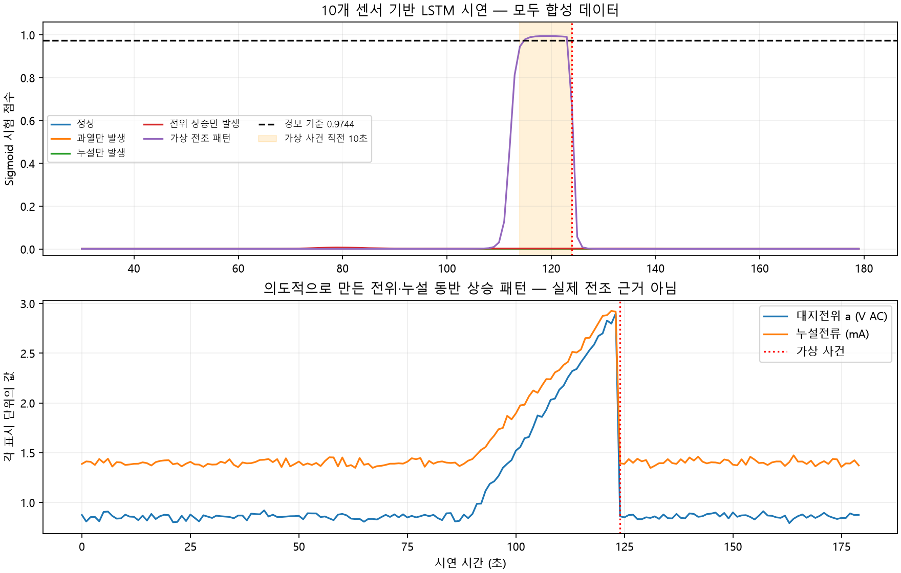
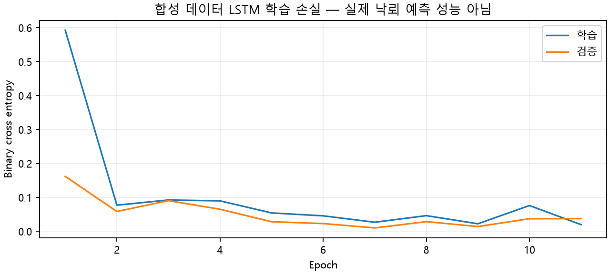
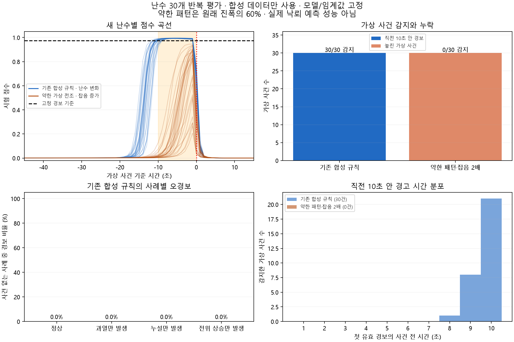

# 센서 10개 기반 LSTM 시연

5주차 과제용 **합성 데이터 기반 시연**입니다. 센서 10개를 처리하고 실제 저장된 LSTM으로 점수를 계산하여 경보와 그래프를 표시합니다. 실제 낙뢰 전조 예측 성능은 검증되지 않았으며 장비 제어 명령은 보내지 않습니다.

## 설치와 실행

Windows와 Python 3.12를 권장합니다. 저장소 폴더에서 다음 명령을 실행합니다.

```powershell
py -3.12 -m venv .venv
.\.venv\Scripts\python.exe -m pip install -r requirements.txt
.\.venv\Scripts\python.exe ground.py
```

TensorFlow 등 실행 라이브러리는 설치 시 다운로드합니다. 가상환경 `.venv`는 용량이 크므로 저장소에 포함하지 않습니다. 이미 활성화된 가상환경에서는 `python ground.py`로 실행합니다. 브라우저가 열리지 않으면 터미널 마지막 Dashboard 경로의 HTML을 직접 엽니다.

## 화면과 결과

정상·과열만 발생·누설만 발생·전위 단독 상승·가상 전조의 5개 상황을 선택합니다. 센서값 10개, LSTM 시험 점수, 경보, 장비 기준 초과 여부와 시간별 그래프를 볼 수 있습니다. 처음 30초는 입력을 수집합니다. 일시정지·처음부터·속도 조절을 지원합니다.

화면은 프로그램이 계산한 추론 결과를 재생합니다. 실제 장비 연결이나 실시간 센서 수신 화면이 아닙니다. 점수는 실제 낙뢰 발생 확률이 아닙니다.





실행할 때마다 `showcase_runs/실행시각`에 dashboard.html, prediction_demo.png, training_loss.png, predictions.csv, summary.json을 저장합니다. 브라우저 자동 열기를 끄려면 `python ground.py --no-open`으로 실행합니다.

## 입력과 모델

입력은 대지전위 a/b, 누설전류, 제한소자 온도 a/b/c, 상대습도, 외기온도, 입력전압, 누적 낙뢰 횟수입니다. 횟수는 증가량의 log1p로 변환하고, 학습 구간에서만 구한 Min-Max 기준으로 정규화합니다. 최근 30초 × 10개를 LSTM64 → LSTM32 → Dense16 → Sigmoid에 입력합니다. 목표는 다음 10초의 가상 사건 여부입니다.

장비 기준은 대지전위 각각 2V AC, 누설전류 2mA, 소자온도 각각 45℃이며 습도 70%·외기온도 25℃는 환경 참고값입니다. 장비 기준 초과와 가상 전조 경보는 별도로 처리합니다.

72개 합성 시나리오를 시간 순서로 학습·검증·시험에 분리했습니다. 전위와 누설의 35초 공동 상승은 사람이 만든 교육용 패턴이며 실제 전조라는 근거는 없습니다. 새로운 난수 시드의 시연에서 정상 및 단독 이상에는 경보가 없었고 가상 사건 9초 전에 경보가 발생했습니다. 실제 관측 성능으로 해석하면 안 됩니다. 상세 합성 평가 결과는 showcase_bundle/evaluation.json에 있습니다.

## 검증과 재학습

```powershell
.\.venv\Scripts\python.exe -m unittest test_showcase test_device_server -v
```

배포한 기능에 해당하는 17개 테스트를 포함합니다. 전처리·입력 오류·카운터 초기화·추론 값·학습 출처·일괄/순차 점수 일치를 검사합니다.

학습 데이터는 원본 대용량 파일 없이 재생성할 수 있습니다. 기존 모델을 덮어쓰지 않도록 새 출력 폴더를 지정합니다.

```powershell
python prepare_showcase.py
python train_device_count.py --frames showcase_training_data/frames.jsonl --events showcase_training_data/events.csv --manifest showcase_training_data/manifest.json --output showcase_bundle_new --epochs 25 --allow-synthetic
```

## 공유 범위

이 저장소의 ground.py는 기본 시연과 `--criteria`, `stdin`만 제공하는 공유용 실행 파일입니다. `python ground.py --criteria`는 기존 7개 기준값 처리 시험입니다. `python ground.py stdin --model-dir showcase_bundle`은 기존 NDJSON 입력 계약에 맞는 입력에 합성 모델 점수를 계산합니다. 실제 장비 통신 어댑터는 없습니다.

공개 기상자료 실험, 외부 데이터 다운로드 파일, 이전 H/L 모델과 실행 로그는 제외했습니다. 로컬 전체 프로젝트의 `--public-demo`, `--legacy`, `--precursor` 실행은 이 배포판에 포함하지 않습니다. 실제 센서 10개 기록과 독립적인 낙뢰 정답을 확보한 뒤 현장 성능을 별도로 검증해야 합니다.

## 난수 반복 평가 추가

기본 실행 `python ground.py`는 모델과 경보 기준을 고정하고 학습에 쓰지 않은 30개 난수 묶음을 평가합니다. 최초 화면 생성까지 반복 추론 시간이 걸립니다. 입력 모음에서 기존 보고서 시연, 새 난수의 기존 합성 규칙, 약한 패턴과 잡음 증가 조건을 선택할 수 있습니다. 난수와 상황을 바꾸고 재생 위치를 이동하여 점수와 입력 10개를 비교합니다. 다른 시드 선택 버튼은 이미 추론한 30개 묶음 중 다른 것을 선택하며, 브라우저에서 모델을 다시 학습하거나 임의 확률을 만드는 기능은 아닙니다.

기존 합성 규칙은 30개 묶음 × 5개 상황 = 150개 사례(가상 사건 30건, 사건 없는 비교 사례 120개)입니다. 별도 민감도 시험은 같은 시드의 전조 상승 진폭을 60%로 줄이고 측정 잡음을 2배로 늘린 가상 전조 30개입니다. 가상 사건시각은 동일하게 유지합니다. 총 180개 사례입니다.

기존 규칙의 사건 감지는 30/30, 정답 구간 재현율 96.67%, 경보 정밀도 97.97%, 정상 구간 오경보율 0.027%였습니다. 사건 없는 비교 사례는 0/120에서 경보했습니다. 사건 직전 10초 밖의 일부 경보 6초는 구간 오경보로 별도 집계했습니다. 약한 패턴은 0/30으로 모두 놓쳤습니다. 모델의 합성 규칙 의존성과 한계를 보여주는 결과이며 실제 낙뢰 성능이 아닙니다.

누적 횟수 1000은 실제 낙뢰 관측 수가 아니라 임의의 시작 기준값입니다. 새 시연 감지 횟수는 0부터 시작하고 가상 사건 뒤에 1이 됩니다. 모델은 누적 총량을 보지 않고 증가량 log1p를 사용합니다. 시작값 0/1000/1000000에서 모델 입력이 같음을 테스트했습니다.

새 저장 결과는 seed_evaluation.png, seed_evaluation.json, seed_evaluation.csv입니다. 사건 감지는 직전 10초 안에 한 번 이상 경보한 경우에만 성공으로 셉니다. 구간 재현율과 사건 감지율은 서로 다른 지표입니다. 기본 시드와 모델 가중치를 바꾸지 않아 기존 보고서 시연 결과를 유지합니다. 빠른 기능 확인은 `python ground.py --no-open --seed-count 3`으로 실행할 수 있습니다. 평가 시드 수는 1~100입니다.



[시드별 평가 결과](docs/seed_evaluation.json)

## 실습 시연 발표 대본

[그대로 읽는 최종 발표 대본](docs/실습시연_최종발표대본.txt)에 화면 조작 순서, 10개 입력, 최근 30개 시점, 점수와 경보의 차이, 난수 평가 그래프 네 개, 약한 패턴의 실패와 예상 질문을 정리했습니다. 실제 장비 연결 및 실제 낙뢰 예측 성능은 검증 전입니다.
