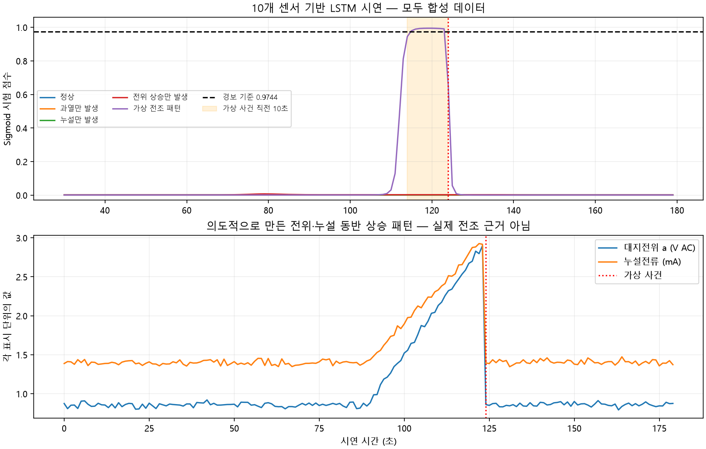
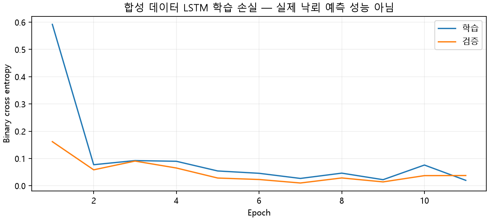
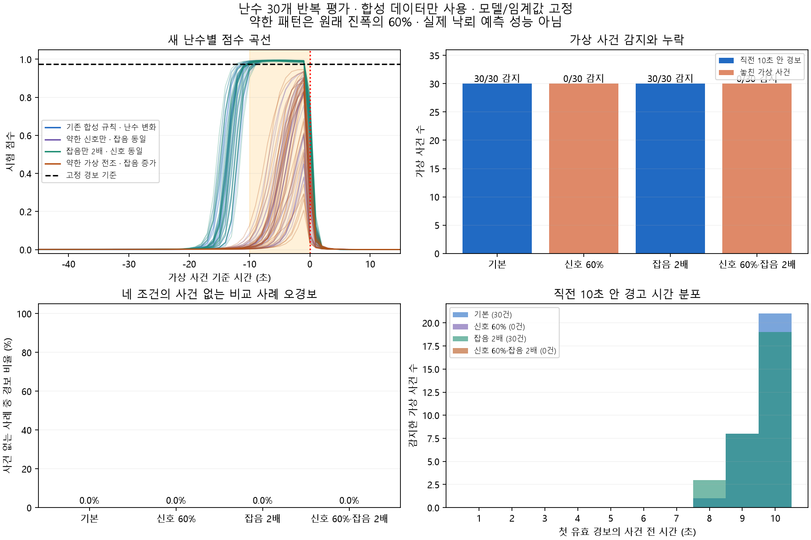

## 최종 보완: 재학습 모델 비교

기본 실행 화면의 **기존 vs 개선 후보 비교 열기**를 누르면 같은 새 시험 데이터에서 두 모델의 점수 곡선과 결과를 볼 수 있습니다. 입력 10개와 30시점 LSTM 구조를 유지하고 학습 패턴을 다양화했습니다. 원래 모델은 보존했고 비교 화면에만 새 후보를 추가했습니다.

새 시험에서 기본 가상 사건 감지는 30/30→30/30, 약한 사건 2/30→29/30, 느린 사건 2/30→30/30입니다. 무사건 회복 사례 경보는 25/30→1/30입니다. 반면 전체 음성 창 오경보율은 0.59%→1.16%로 증가했습니다. 사건보다 10초 넘게 이른 경보가 남아 있으며 실제 낙뢰 성능으로 해석하지 않습니다.

학습 216·검증 90·시험 270개 사례를 시드 단위로 분리했습니다. 가중치와 경보 기준은 검증 데이터로만 선택하고 시험은 이후 한 번 평가했습니다. 기존 가중치의 경보 기준만 새 검증 자료로 조정한 참고 비교도 포함합니다. [전체 설명과 발표 문장](docs/최종보완_모델비교.md).

재현: `python improve_showcase.py --output 새로운_출력폴더 --epochs 20`. 기존 폴더를 덮어쓰지 않습니다. 새 모델은 `week6_improved_bundle`에 저장했습니다.

## 기본 실행: 5주차 보완판

`python ground.py`는 이제 `week5_simple/index.html`에 저장된 2026-10-28 계산 결과를 바로 엽니다. 상황 선택과 자동 그래프 재생이 중심이며 모델·Min-Max·30개 시점·경보 기준은 유지합니다. 추가 난수 비교와 평가 표는 접힌 메뉴에서 볼 수 있습니다. 직접 입력·사건 등록·모의 보호·외부 기상 실험은 기본 발표 흐름에서 제외했습니다. 이전 확장 기능 파일은 보관합니다.

모델과 난수 평가를 다시 계산하려면 `python ground.py --showcase`를 사용하세요. 아래 이전 기능 설명 중 기본 실행 시 재계산된다는 내용은 이 변경으로 대체됩니다. 저장 결과의 재생은 실제 센서 수신이나 새 예측 계산이 아닙니다.
# 센서 10개 기반 LSTM 시연

5~6주차 과제용 **합성 데이터 기반 시연**입니다. 센서 10개를 처리하고 실제 저장된 LSTM으로 점수를 계산하여 경보와 그래프를 표시합니다. 실제 낙뢰 전조 예측 성능은 검증되지 않았으며 장비 제어 명령은 보내지 않습니다.

## 설치와 실행

Windows와 Python 3.12를 권장합니다. 저장소 폴더에서 다음 명령을 실행합니다.

```powershell
py -3.12 -m venv .venv
.\.venv\Scripts\python.exe -m pip install -r requirements.txt
.\.venv\Scripts\python.exe ground.py
```

TensorFlow 등 실행 라이브러리는 설치 시 다운로드합니다. 가상환경 `.venv`는 용량이 크므로 저장소에 포함하지 않습니다. 이미 활성화된 가상환경에서는 `python ground.py`로 실행합니다. 브라우저가 열리지 않으면 터미널 마지막 Dashboard 경로의 HTML을 직접 엽니다.

## 화면과 결과

정상·과열만 발생·누설만 발생·전위 단독 상승·가상 전조의 5개 상황을 선택합니다. 센서값 10개, LSTM 시험 점수, 경보, 장비 기준 초과 여부와 시간별 그래프를 볼 수 있습니다. 처음 30초는 입력을 수집합니다. 일시정지·처음부터·속도 조절을 지원합니다.

화면은 프로그램이 계산한 추론 결과를 재생합니다. 실제 장비 연결이나 실시간 센서 수신 화면이 아닙니다. 점수는 실제 낙뢰 발생 확률이 아닙니다.





실행할 때마다 `showcase_runs/실행시각`에 dashboard.html, prediction_demo.png, training_loss.png, predictions.csv, summary.json을 저장합니다. 브라우저 자동 열기를 끄려면 `python ground.py --no-open`으로 실행합니다.

## 입력과 모델

입력은 대지전위 a/b, 누설전류, 제한소자 온도 a/b/c, 상대습도, 외기온도, 입력전압, 누적 낙뢰 횟수입니다. 횟수는 증가량의 log1p로 변환하고, 학습 구간에서만 구한 Min-Max 기준으로 정규화합니다. 최근 30초 × 10개를 LSTM64 → LSTM32 → Dense16 → Sigmoid에 입력합니다. 목표는 다음 10초의 가상 사건 여부입니다.

장비 기준은 대지전위 각각 2V AC, 누설전류 2mA, 소자온도 각각 45℃이며 습도 70%·외기온도 25℃는 환경 참고값입니다. 장비 기준 초과와 가상 전조 경보는 별도로 처리합니다.

72개 합성 시나리오를 시간 순서로 학습·검증·시험에 분리했습니다. 전위와 누설의 35초 공동 상승은 사람이 만든 교육용 패턴이며 실제 전조라는 근거는 없습니다. 새로운 난수 시드의 시연에서 정상 및 단독 이상에는 경보가 없었고 가상 사건 9초 전에 경보가 발생했습니다. 실제 관측 성능으로 해석하면 안 됩니다. 상세 합성 평가 결과는 showcase_bundle/evaluation.json에 있습니다.

## 검증과 재학습

```powershell
.\.venv\Scripts\python.exe -m unittest test_showcase test_device_server test_simulated_protection -v
```

배포한 기능에 해당하는 22개 테스트를 포함합니다. 모의 보호의 연속 경보, 응답 지연, 센서·시간 누락도 검사합니다. 전처리·입력 오류·카운터 초기화·추론 값·학습 출처·일괄/순차 점수 일치를 검사합니다.

학습 데이터는 원본 대용량 파일 없이 재생성할 수 있습니다. 기존 모델을 덮어쓰지 않도록 새 출력 폴더를 지정합니다.

```powershell
python prepare_showcase.py
python train_device_count.py --frames showcase_training_data/frames.jsonl --events showcase_training_data/events.csv --manifest showcase_training_data/manifest.json --output showcase_bundle_new --epochs 25 --allow-synthetic
```

## 공유 범위

이 저장소의 ground.py는 기본 시연과 `--criteria`, `stdin`만 제공하는 공유용 실행 파일입니다. `python ground.py --criteria`는 기존 7개 기준값 처리 시험입니다. `python ground.py stdin --model-dir showcase_bundle`은 기존 NDJSON 입력 계약에 맞는 입력에 합성 모델 점수를 계산합니다. 실제 장비 통신 어댑터는 없습니다.

공개 기상자료 실험, 외부 데이터 다운로드 파일, 이전 H/L 모델과 실행 로그는 제외했습니다. 로컬 전체 프로젝트의 `--public-demo`, `--legacy`, `--precursor` 실행은 이 배포판에 포함하지 않습니다. 실제 센서 10개 기록과 독립적인 낙뢰 정답을 확보한 뒤 현장 성능을 별도로 검증해야 합니다.

## 6주차 난수 평가와 모의 보호 동작

기존 입력 10개, Min-Max, 30개 시점 LSTM과 경보 기준을 유지합니다. 기본 실행은 30개 난수 묶음 × 4조건 × 5상황 = 600개 사례를 계산합니다. 조건 사이에는 같은 시드를 사용하므로 모두 독립 표본은 아닙니다. 빠른 확인은 `python ground.py --seed-count 1`입니다.

| 합성 시험 조건 | 가상 사건 경보 | 초 단위 재현율 | 사건 없는 사례 경보 |
|---|---:|---:|---:|
| 기본 | 30/30 | 96.67% | 0/120 |
| 신호 60%만 | 0/30 | 0.00% | 0/120 |
| 잡음 2배만 | 30/30 | 95.33% | 0/120 |
| 신호 60%·잡음 2배 | 0/30 | 0.00% | 0/120 |

사건 직전 10초 내 한 번 이상 기준을 넘으면 사건 경보 성공으로 셉니다. 신호 조절은 전위·누설의 동반 상승 폭이며, 잡음 배율은 전위·누설·입력전압에 적용합니다. 이 시험에서는 신호를 약하게 만드는 것만으로도 누락했습니다. 실제 낙뢰 성능이나 모든 잡음에 대한 강건성을 뜻하지 않습니다.



경보 3회 연속이면 모의 보호 요청을 만들고, 모의 응답기는 1초 뒤 응답합니다. 3초까지 응답이 없으면 TIMEOUT입니다. 센서 누락과 시간 누락은 DATA_FAULT로 기록합니다. 시간 설정은 실습용이며 업체 사양이 아닙니다. 실제 통신·차단·전압 변경은 없습니다. 기존 가상 전조 시연은 115초 경보 → 117초 모의 요청 → 118초 모의 응답 확인 순입니다.

화면에서 상태 전이와 별도 오류 주입 시험을 확인할 수 있고 `protection_log.json`에 저장합니다. 오류 주입 시험은 제어 로직 시험이며 LSTM 예측 성능 시험이 아닙니다. 사건 경보 평가와 연속 3회 모의 보호 평가는 구분해야 합니다.

누적 횟수 1000은 임의 시작값이며 모델은 증가량의 log1p를 사용합니다. 실제 관측 1000건이라는 의미가 아닙니다.

[6주차 전체 설명](docs/6주차_시연설명.md) · [6주차 읽는 발표 대본](docs/6주차_최종시연대본.txt) · [평가 원결과](docs/week6_seed_evaluation.json)

이전 [5주차 대본](docs/실습시연_최종발표대본.txt)은 이전 버전의 기록입니다.

## 6주차 외부 실측 평가

기본 실행 화면 맨 아래의 **참고 자료: 별도 외부 관측 실험**을 펼친 뒤 **외부 실측 평가 열기**에서 공개 관측소 5곳의 예측 결과와 성공·누락·오경보 사례를 확인합니다. 재계산을 기다리지 않고 `external_evaluation_report/index.html`을 직접 열어도 됩니다. 발표 설명은 같은 폴더의 `발표설명.txt`에 있습니다.

기존 CIRAD ATMOS41 실측 실험을 원자료 해시, 미래 정답, 저장 모델 재추론으로 확인했습니다. 기존 시험 기간의 재현이며 새로운 독립 시험은 아닙니다. 74,525개 예측 창에서 재현율 44.58%, 정밀도 58.33%, 음성 창 오경보율 0.84%입니다. 과거 150분 무감지 조건의 재현율은 1.16%로 낮습니다. 150분 무감지 후 활동 시작을 별도 집계하면 평가 가능한 126개 중 5개를 직전 30분 안에 경고했습니다. 정확한 방전 시각이 아니라 5분 기록 시각 기준입니다.

외부 모델은 8개 기상·과거 활동 변수의 150분 이력으로 다음 30분 센서 활동을 예측하는 HistGradientBoosting입니다. 기존 장비 10개 입력 LSTM과 별도이며, 지면 낙뢰(CG) 정답이나 한국 장비 검증이 아닙니다. 두 점수를 합산하지 않습니다. 출처·저자·라이선스·가공 내역은 보고서의 SOURCE.txt에 있습니다.

전체 자료를 가진 로컬 환경에서 재현하려면 `python build_real_observation_report.py --source "전체 ground 폴더" --output "새 결과 폴더"`를 실행합니다. source에는 external_weather_model.py, sensor10_pipeline.py, real_data_research/weather_core.py, external_weather_inputs와 external_weather_bundle이 필요합니다. 원본 대용량 자료는 이 저장소에 포함하지 않았습니다. 출처 DOI: https://doi.org/10.18167/DVN1/S7DNJG

## 센서 직접 입력 실험실

`python ground.py --manual`을 실행하면 자신의 PC에서만 접속하는 `http://127.0.0.1:8769/` 화면이 열립니다. 센서 10개 수치를 직접 수정하고 1초 추가·같은 값 30초 채우기·자동 입력으로 이력을 쌓아 기존 LSTM 점수를 계산합니다. 누설전류 UI는 mA, CSV는 A입니다. CSV 양식 다운로드·업로드와 결과 JSON 저장을 지원합니다.

첫 누적 횟수는 기준값으로 쓰므로 첫 점수는 31행부터 계산합니다. 시간 누락·횟수 초기화 뒤에는 다시 이력을 모읍니다. 각 입력 행은 최신 관측으로 가정한 수동 실험이며 실제 센서 통신은 없습니다. 합성 학습 모델의 가상 전조 패턴 점수이며 실제 낙뢰 발생 여부·시각·확률은 검증하지 않습니다. 입력에 맞춰 정답 사건을 자동으로 만들지 않습니다. 종료는 Ctrl+C입니다. 자세한 조작은 [직접입력 사용법](직접입력_사용법.txt)을 참고하세요.

직접 입력 화면 3번 영역에서 가상/외부 관측 사건을 별도로 기록하거나 사건 CSV를 가져와 직전 10초 예측을 평가합니다. 완전한 사전 점수 이력이 없는 사건과 미래 사건은 제외/대기 처리합니다. 오경보 비율은 사건 목록 완전성을 사용자가 확인한 구간에서만 계산하고 기록 끝의 미확인 미래는 제외합니다. 외부 관측 업로드는 실제 낙뢰 검증 완료를 의미하지 않습니다. 전체 테스트: 33개 통과.
